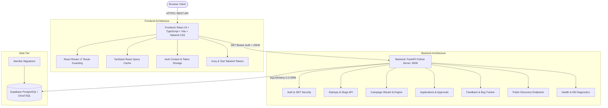
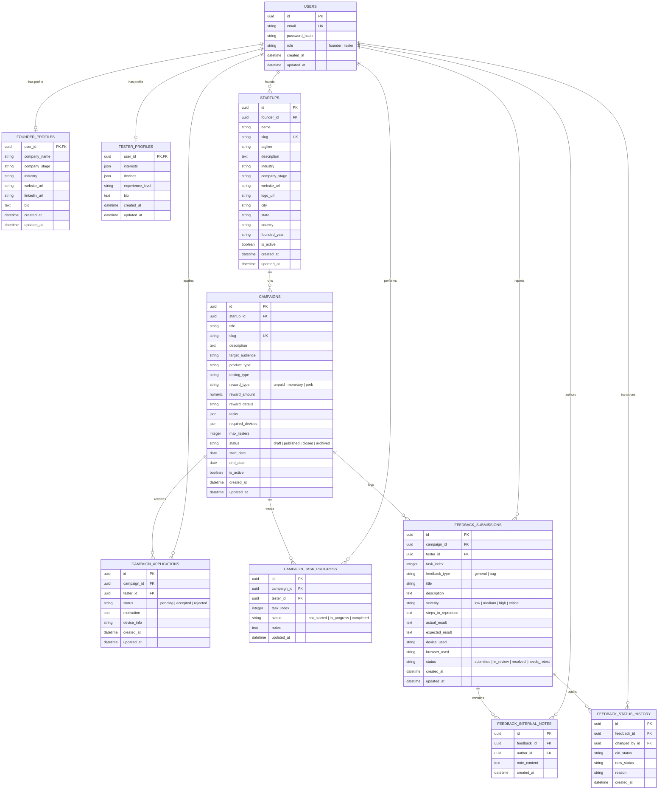

# TryLo — Complete Architecture & Engineering Reference Guide (`learningDox.md`)

Welcome to the comprehensive architecture, design, and engineering manual for **TryLo** — a high-assurance, modern beta-testing and startup discovery marketplace connecting early-stage founders with passionate beta testers across India and beyond.

---

## Table of Contents
1. [Executive Overview & Product Vision](#1-executive-overview--product-vision)
2. [High-Level System Architecture](#2-high-level-system-architecture)
3. [Technology Stack](#3-technology-stack)
4. [Database Architecture & Entity Relationships](#4-database-architecture--entity-relationships)
5. [Backend Architecture & API Specification](#5-backend-architecture--api-specification)
6. [Frontend Architecture & Design System](#6-frontend-architecture--design-system)
7. [Key End-to-End User Workflows](#7-key-end-to-end-user-workflows)
8. [Security, Performance & Validation Strategies](#8-security-performance--validation-strategies)
9. [Local Development, Environment & Runbook](#9-local-development-environment--runbook)

---

## 1. Executive Overview & Product Vision

### 1.1 What is TryLo?
**TryLo** is a specialized two-sided marketplace designed to bridge the critical gap between early-stage product builders (**Founders**) and curious early adopters (**Beta Testers**).

- **For Founders**: Building a product in a vacuum leads to high failure rates. TryLo allows founders to list their startups, design structured beta campaigns, recruit targeted testers, assign tasks, and gather prioritized, actionable feedback and bug reports with hardware/browser diagnostics before their public launch.
- **For Testers**: Tech enthusiasts, designers, QA engineers, and everyday users can discover cutting-edge software and hardware products before anyone else, test real features, earn rewards/perks, and directly impact the development roadmap of upcoming ventures.

### 1.2 Two-Sided Platform Flywheel

```
┌────────────────────────────────────────────────────────┐
│                      TRYLO FLYWHEEL                    │
│                                                        │
│   Founders List Startups & Launch Structured Campaigns │
│                          │                             │
│                          ▼                             │
│       Passionate Testers Apply & Test Real Features    │
│                          │                             │
│                          ▼                             │
│   High-Quality Bug Reports, Diagnostics & Feedback     │
│                          │                             │
│                          ▼                             │
│   Better Product-Market Fit & Verified Public Launch  │
└────────────────────────────────────────────────────────┘
```

---

## 2. High-Level System Architecture

TryLo is architected as a clean, decoupled client-server system:



---

## 3. Technology Stack

### 3.1 Backend
- **Framework**: [FastAPI](https://fastapi.tiangolo.com/) (Python 3.13 / 3.12)
  - Async request handling with ASGI (`uvicorn`).
  - Automatic OpenAPI / Swagger interactive documentation (`/docs` and `/redoc`).
  - Native Pydantic v2 schemas for robust request/response validation.
- **ORM & Database Driver**: [SQLAlchemy 2.0](https://www.sqlalchemy.org/) with `psycopg3` (PostgreSQL binary driver).
- **Database Engine**: [PostgreSQL](https://www.postgresql.org/) (hosted on Supabase Cloud Pooler).
- **Database Migrations**: [Alembic](https://alembic.sqlalchemy.org/) for version-controlled schema evolution.
- **Security & Authentication**:
  - `python-jose` for JWT access and refresh token generation/verification.
  - `passlib` with `bcrypt` for one-way password hashing and salting.
  - Dependency Injection with FastAPI OAuth2 bearer schemes.

### 3.2 Frontend
- **Runtime & Core**: [React 19](https://react.dev/) + [TypeScript](https://www.typescriptlang.org/) (strict mode).
- **Build Tool**: [Vite 8](https://vitejs.dev/) with lightning-fast HMR and Rollup production bundling.
- **Styling & Design Tokens**: [Tailwind CSS v4](https://tailwindcss.com/) with a custom Ivory & Teal design system.
- **Client Routing**: [React Router v7](https://reactrouter.com/) featuring:
  - Route-level code-splitting with `React.lazy` and `Suspense`.
  - Role-guarded routes (`ProtectedRoute`).
  - Profile completion enforcement (`WorkspaceGuard`).
- **Data Fetching & Server State**: [TanStack Query v5](https://tanstack.com/query/latest) (React Query):
  - Stale-while-revalidate caching.
  - Automatic background refetching and cache invalidation on mutations.
- **Icons**: [Lucide React](https://lucide.dev/) for unified, lightweight SVG iconography.

---

## 4. Database Architecture & Entity Relationships

### 4.1 Entity-Relationship Diagram (ERD)



---

### 4.2 Detailed Database Table Definitions

#### `users`
- `id` (`UUID`, Primary Key, default UUIDv4)
- `email` (`VARCHAR(255)`, Unique, Not Null, Indexed, lowercased)
- `password_hash` (`VARCHAR(255)`, Not Null, salted bcrypt)
- `role` (`VARCHAR(50)`, Not Null, `founder` or `tester`)
- `created_at` (`TIMESTAMPTZ`, default `now()`)
- `updated_at` (`TIMESTAMPTZ`, auto-updating)

#### `founder_profiles`
- `user_id` (`UUID`, PK, Foreign Key -> `users.id` on delete CASCADE)
- `company_name` (`VARCHAR(200)`, Nullable)
- `company_stage` (`VARCHAR(50)`, Enum: `Idea`, `Prototype`, `MVP`, `Early Traction`, `Growth`, `Scaling`)
- `industry` (`VARCHAR(100)`, Nullable)
- `website_url` (`VARCHAR(500)`, Validated URL)
- `linkedin_url` (`VARCHAR(500)`, Validated LinkedIn URL)
- `bio` (`TEXT`, max 2000 chars)

#### `tester_profiles`
- `user_id` (`UUID`, PK, Foreign Key -> `users.id` on delete CASCADE)
- `interests` (`JSONB` / `JSON`, array of string tags e.g. `["FinTech", "HealthTech", "AI"]`)
- `devices` (`JSONB` / `JSON`, array of hardware devices e.g. `["iPhone 15", "macOS Sonoma", "Android 14"]`)
- `experience_level` (`VARCHAR(50)`, Enum: `Beginner`, `Intermediate`, `Advanced`, `Professional QA`)
- `bio` (`TEXT`, max 2000 chars)

#### `startups`
- `id` (`UUID`, Primary Key)
- `founder_id` (`UUID`, Foreign Key -> `users.id` on delete CASCADE, Indexed)
- `name` (`VARCHAR(200)`, Not Null)
- `slug` (`VARCHAR(250)`, Unique, Not Null, URL-friendly slug e.g. `girlyio`, `nutribox`)
- `tagline` (`VARCHAR(255)`, Short elevator pitch)
- `description` (`TEXT`, Detailed product summary)
- `industry` (`VARCHAR(100)`, e.g. `HealthTech`, `FinTech`, `EdTech`, `CPG`)
- `company_stage` (`VARCHAR(50)`, e.g. `MVP`, `Early Traction`)
- `website_url` (`VARCHAR(500)`, Optional valid URL)
- `logo_url` (`VARCHAR(500)`, Optional logo image URL)
- `city` (`VARCHAR(100)`, e.g. `Bengaluru`, `Hyderabad`, `Indore`)
- `state` (`VARCHAR(100)`, e.g. `Madhya Pradesh`, `Andhra Pradesh`, `Maharashtra`)
- `country` (`VARCHAR(100)`, default `India`)
- `founded_year` (`VARCHAR(4)`, e.g. `2025`)
- `is_active` (`BOOLEAN`, default `TRUE`)

#### `campaigns`
- `id` (`UUID`, Primary Key)
- `startup_id` (`UUID`, Foreign Key -> `startups.id` on delete CASCADE, Indexed)
- `title` (`VARCHAR(200)`, Not Null)
- `slug` (`VARCHAR(250)`, Unique, Not Null)
- `description` (`TEXT`, Not Null)
- `target_audience` (`TEXT`, e.g. "Females aged 18-35 tracking hormonal wellness")
- `product_type` (`VARCHAR(50)`, Enum: `Web App`, `Mobile App (iOS)`, `Mobile App (Android)`, `Desktop Software`, `Hardware / Physical Device`)
- `testing_type` (`VARCHAR(50)`, Enum: `Functional & Bug Hunting`, `Usability & UX Review`, `Performance & Stress Testing`)
- `reward_type` (`VARCHAR(50)`, Enum: `unpaid`, `monetary`, `perk`)
- `reward_amount` (`NUMERIC(10,2)`, Optional cash incentive amount in INR)
- `reward_details` (`VARCHAR(500)`, e.g. "Free 6 months Pro subscription & ₹500 Amazon Gift Voucher")
- `tasks` (`JSONB` / `JSON`, array of structured task objects with `title`, `description`, `required`)
- `required_devices` (`JSONB` / `JSON`, array of device specifications)
- `max_testers` (`INTEGER`, default `25`, range 1-500)
- `status` (`VARCHAR(50)`, State Machine: `draft` -> `published` -> `closed` -> `archived`)
- `start_date` (`DATE`, Optional)
- `end_date` (`DATE`, Optional)
- `is_active` (`BOOLEAN`, default `TRUE`)

#### `campaign_applications`
- `id` (`UUID`, Primary Key)
- `campaign_id` (`UUID`, Foreign Key -> `campaigns.id` on delete CASCADE, Indexed)
- `tester_id` (`UUID`, Foreign Key -> `users.id` on delete CASCADE, Indexed)
- `status` (`VARCHAR(50)`, Enum: `pending`, `accepted`, `rejected`)
- `motivation` (`TEXT`, Cover note why the tester wants to test this product)
- `device_info` (`VARCHAR(255)`, Exact device specs used for testing)
- **Constraint**: Unique composite index on `(campaign_id, tester_id)` preventing duplicate applications.

#### `campaign_task_progress`
- `id` (`UUID`, Primary Key)
- `campaign_id` (`UUID`, Foreign Key -> `campaigns.id` on delete CASCADE)
- `tester_id` (`UUID`, Foreign Key -> `users.id` on delete CASCADE)
- `task_index` (`INTEGER`, 0-based index matching the campaign tasks list)
- `status` (`VARCHAR(50)`, Enum: `not_started`, `in_progress`, `completed`)
- `notes` (`TEXT`, Tester completion notes)
- **Constraint**: Unique composite index on `(campaign_id, tester_id, task_index)`.

#### `feedback_submissions`
- `id` (`UUID`, Primary Key)
- `campaign_id` (`UUID`, Foreign Key -> `campaigns.id` on delete CASCADE, Indexed)
- `tester_id` (`UUID`, Foreign Key -> `users.id` on delete CASCADE, Indexed)
- `task_index` (`INTEGER`, Nullable if general feedback)
- `feedback_type` (`VARCHAR(50)`, Enum: `general`, `bug`)
- `title` (`VARCHAR(250)`, Not Null)
- `description` (`TEXT`, Detailed feedback)
- `severity` (`VARCHAR(50)`, Enum: `low`, `medium`, `high`, `critical`)
- `steps_to_reproduce` (`TEXT`, Step 1, Step 2, Step 3...)
- `actual_result` (`TEXT`, What actually happened)
- `expected_result` (`TEXT`, What should have happened)
- `device_used` (`VARCHAR(100)`, e.g. "iPhone 15 Pro, iOS 18.1")
- `browser_used` (`VARCHAR(100)`, e.g. "Safari Mobile 18.0")
- `status` (`VARCHAR(50)`, State Machine: `submitted` -> `in_review` -> `resolved` -> `needs_retest`)

#### `feedback_internal_notes` & `feedback_status_history`
- Audit log and internal founder notes enabling collaborative review, developer assignments, and state transition histories.

---

### 4.3 Key State Machines

```
┌────────────────────────────────────────────────────────┐
│                   CAMPAIGN STATUS                      │
│                                                        │
│   [ draft ] ────► [ published ] ────► [ closed ]       │
│                         │                   │          │
│                         └─────────┬─────────┘          │
│                                   ▼                    │
│                             [ archived ]               │
└────────────────────────────────────────────────────────┘

┌────────────────────────────────────────────────────────┐
│                 APPLICATION STATUS                     │
│                                                        │
│                    [ pending ]                         │
│                         │                              │
│                ┌────────┴────────┐                     │
│                ▼                 ▼                     │
│           [ accepted ]      [ rejected ]               │
└────────────────────────────────────────────────────────┘

┌────────────────────────────────────────────────────────┐
│                   FEEDBACK STATUS                      │
│                                                        │
│                   [ submitted ]                        │
│                         │                              │
│                         ▼                              │
│                    [ in_review ]                       │
│                         │                              │
│                ┌────────┴────────┐                     │
│                ▼                 ▼                     │
│          [ resolved ] ◄───► [ needs_retest ]           │
└────────────────────────────────────────────────────────┘
```

---

## 5. Backend Architecture & API Specification

### 5.1 Directory Structure
```
backend/
├── alembic/                      # Database migrations
│   ├── env.py
│   └── versions/
├── app/
│   ├── api/                      # Route handlers
│   │   ├── applications.py       # Tester applications & founder review
│   │   ├── auth.py               # Register, login, refresh, logout
│   │   ├── campaigns.py          # Campaign CRUD & wizard
│   │   ├── deps.py               # Dependency injection & security guards
│   │   ├── feedback.py           # Bug reports & feedback triage
│   │   ├── health.py             # Healthcheck & DB ping
│   │   ├── profiles.py           # Founder & tester onboarding
│   │   ├── public.py             # Anonymous campaign & startup discovery
│   │   ├── startups.py           # Founder startup CRUD
│   │   └── tasks.py              # Task checklist & progress tracker
│   ├── core/
│   │   ├── config.py             # Environment settings & Pydantic BaseSettings
│   │   └── security.py           # Bcrypt hashing & JWT token operations
│   ├── db/
│   │   ├── base.py               # SQLAlchemy DeclarativeBase
│   │   └── session.py            # Async/sync engine & sessionmaker
│   ├── models/                   # SQLAlchemy ORM classes
│   └── schemas/                  # Pydantic request & response validation
├── tests/                        # Comprehensive pytest suite
├── alembic.ini
├── requirements.txt
└── .env
```

### 5.2 Security & Authentication Workflow
1. **User Registration (`POST /api/auth/register`)**:
   - Accepts `email`, `password` (min 8 chars), and `role` (`founder` or `tester`).
   - Normalizes email to lowercase.
   - Hashes password using bcrypt.
   - Issues short-lived access JWT (`ACCESS_TOKEN_EXPIRE_MINUTES=60`) and long-lived refresh JWT (`REFRESH_TOKEN_EXPIRE_DAYS=7`).
2. **User Authentication (`POST /api/auth/login`)**:
   - Verifies credentials against database hash.
   - Returns JWT bearer token payload along with the user's role and profile completion status.
3. **Dependency-Injected Guards (`app/api/deps.py`)**:
   - `get_current_user`: Decodes JWT, validates signature, ensures user exists.
   - `require_founder`: Enforces `user.role == "founder"`, raises `403 Forbidden` otherwise.
   - `require_tester`: Enforces `user.role == "tester"`, raises `403 Forbidden` otherwise.

### 5.3 Core API Endpoints Catalog

| Method | Endpoint | Access | Description |
|---|---|---|---|
| `POST` | `/api/auth/register` | Public | Register new founder or tester account |
| `POST` | `/api/auth/login` | Public | Authenticate user and receive JWT tokens |
| `GET` | `/api/auth/me` | Authenticated | Retrieve current user profile and session info |
| `GET` | `/api/profiles/me` | Authenticated | Fetch role-specific founder or tester profile |
| `PUT` | `/api/profiles/founder` | Founder | Complete or update founder profile |
| `PUT` | `/api/profiles/tester` | Tester | Complete or update tester profile |
| `GET` | `/api/startups` | Founder | List startups owned by authenticated founder |
| `POST` | `/api/startups` | Founder | Create a new startup profile (auto-slugified) |
| `GET` | `/api/startups/{id}` | Founder | Get startup details with associated campaigns |
| `PUT` | `/api/startups/{id}` | Founder | Update startup details, tagline, city, website |
| `GET` | `/api/campaigns` | Founder | List all campaigns owned by the founder |
| `POST` | `/api/campaigns` | Founder | Launch a new campaign via Campaign Wizard |
| `GET` | `/api/campaigns/{id}` | Founder | Get campaign details, tasks list, and applicant counts |
| `PUT` | `/api/campaigns/{id}/status` | Founder | Transition campaign state (`published`, `closed`) |
| `GET` | `/api/applications/campaign/{id}` | Founder | Review all applicants for a specific campaign |
| `PUT` | `/api/applications/{id}/status` | Founder | Accept or reject a tester application |
| `GET` | `/api/tester/discover` | Tester | Search & filter published campaigns by category/reward |
| `POST` | `/api/applications/apply` | Tester | Submit application to join a beta campaign |
| `GET` | `/api/tester/my-applications` | Tester | View personal application statuses |
| `GET` | `/api/tester/tasks/{campaign_id}` | Accepted Tester | View assigned testing checklist & mark tasks |
| `POST` | `/api/feedback/submit` | Accepted Tester | Submit bug report or qualitative feedback |
| `GET` | `/api/feedback/founder` | Founder | Feedback triage dashboard with severity filters |
| `PUT` | `/api/feedback/{id}/status` | Founder | Update bug status (`in_review`, `resolved`, `needs_retest`) |
| `GET` | `/api/public/startups` | Public | Public directory with state counts for India Map |
| `GET` | `/api/public/startups/{slug}` | Public | Public landing page for a specific startup |
| `GET` | `/api/public/campaigns/{id}` | Public | Public preview of an active beta campaign |
| `GET` | `/api/health` | Public | Real-time healthcheck & PostgreSQL connection ping |

---

## 6. Frontend Architecture & Design System

### 6.1 Design Tokens & Aesthetics
The TryLo frontend adheres to an **Ivory & Teal** visual design system:

| Token Name | Hex Code | Purpose |
|---|---|---|
| **Background Ivory** | `#F6F5ED` | Primary page canvas; warm, organic, glare-free |
| **Card Surface** | `#FFFFFF` | Crisp elevated surfaces with subtle borders |
| **Deep Forest Primary** | `#07545A` | Brand buttons, hero titles, high-contrast actions |
| **Vibrant Teal** | `#087C80` | Interactive states, links, hover rings, icon accents |
| **Soft Mint** | `#D7EFEB` | Category pills, active badges, ambient glow accents |
| **Slate Charcoal** | `#102A35` | Primary headings and high-priority body text |
| **Muted Sage** | `#52656B` | Secondary descriptions, timestamps, metadata |
| **Border Soft** | `#DCE7E3` | Subtle border separators maintaining structured cards |

### 6.2 Key Architectural Components

#### 1. Interactive India Vector Map (`IndiaStartupMap.tsx`)
- High-precision SVG vector map of all 28 states and union territories of India.
- **On-Demand Click Behavior**: The state preview card remains hidden by default. Clicking any state activates the popup, revealing real startups located in that region.
- **Close & Toggle**: Clicking the `✕` close button or re-clicking the state dismisses the modal card.
- **Dynamic Startup Avatars**: Startups in each state render their authentic logo or fall back to a rich **Alphabet Monogram** (`StartupAvatar`), preventing empty or mismatched placeholder visuals.

#### 2. Hero Section 3D Fanned Perspective Deck (`HeroSection.tsx`)
- Smooth 3D perspective deck fanned with parabolic translation (`translateX`, `translateY`, `rotateZ`).
- Displays startups with authentic imagery:
  - **Girlyio**: Aesthetic women's healthcare cycle tracking mobile app mockup (`app-girlyio.jpg`).
  - **Bloomly**: Female founder holding organic botanical skincare product (`founder-bloomly.jpg`).
  - **NutriBox**: Gourmet organic nutrient protein bar (`product-nutribox.jpg`).
  - **FinMate**: FinTech founder holding wealth management dashboard (`founder-finmate.jpg`).
  - **EcoKart**: Luxury sustainable subscription box with embossed monogram (`product-ecokart.jpg`).
- Dynamic mouse parallax interaction with reduced-motion accessibility overrides.

#### 3. Reusable Startup Avatar & Monogram System (`StartupAvatar.tsx`)
- Deterministically generates elegant 1-2 letter monograms (e.g., `GI` for Girlyio, `FH` for FemmeCare Health) when a custom logo URL is not available or unreachable.
- Features multi-gradient palettes (Teal, Rose/Pink, Indigo, Coral, Emerald, Purple) with glass highlights and subtle category tags.
- Provides real-time preview feedback on the **Startup Creation** and **Startup Editing** pages.

#### 4. Official Brand Logo (`BrandLogo.tsx`, `Header.tsx`, `Footer.tsx`)
- Renders the official TryLo emblem: two intertwined figures in teal and coral forming an infinity ribbon loop, symbolizing the symbiotic bond between founders and testers.
- Integrated seamlessly in navigation headers, footers, and browser tab favicons.

---

## 7. Key End-to-End User Workflows

### 7.1 The Founder Journey
1. **Sign Up**: Registers as a `founder`.
2. **Onboarding**: Fills out `FounderOnboardingPage` with company stage, industry, and bio.
3. **Register Startup**: Creates a startup profile on `StartupCreatePage` (city, state, website, logo with live monogram preview).
4. **Create Campaign**: Uses the `CampaignWizardPage` to define product type, target audience, testing checklist, and reward structure (Unpaid, Cash, or Perks).
5. **Review Testers**: Founders review incoming tester applications, inspect device configurations, and approve or reject candidates.
6. **Triage Feedback**: Inspects submitted bug reports with device diagnostics, changes status to `in_review` or `resolved`, and logs internal notes.

### 7.2 The Tester Journey
1. **Sign Up**: Registers as a `tester`.
2. **Onboarding**: Selects devices owned (iOS, Android, Mac, PC) and tech interests on `TesterOnboardingPage`.
3. **Discover Campaigns**: Explores `TesterDiscoverPage`, filtering by category, platform, or reward type.
4. **Apply**: Submits a brief motivation statement and confirms their testing device.
5. **Execute Tasks**: Once accepted, opens `TesterTasksPage`, follows the founder's structured checklist, and marks progress.
6. **Submit Bugs & Feedback**: Opens `FeedbackSubmissionPage` to record bug steps, expected vs. actual outcomes, and system configurations.

---

## 8. Security, Performance & Validation Strategies

### 8.1 Data Validation
- **Pydantic v2**: Strictest type coercion and field validators. URL fields are validated to ensure valid schemes (`http`, `https`) and fully qualified domain names.
- **SQL Injection Prevention**: 100% parameterized queries via SQLAlchemy 2.0 ORM expressions.
- **XSS Mitigation**: React JSX automatically escapes dynamic values. No `dangerouslySetInnerHTML` is used for user-submitted content.

### 8.2 Client Performance
- **Route-Level Code Splitting**: All 27 pages are lazily loaded with dynamic `import()` and `Suspense`, keeping the initial entry chunk small and fast.
- **Stale-While-Revalidate**: TanStack Query minimizes network requests by serving cached data instantly while refreshing in the background.

---

## 9. Local Development, Environment & Runbook

### 9.1 Environment Configuration

#### Backend `.env` (`backend/.env`):
```ini
APP_ENV=development
HOST=127.0.0.1
PORT=8000
CORS_ORIGINS=http://localhost:5173,http://127.0.0.1:5173
DATABASE_URL=postgresql://postgres:[PASSWORD]@[HOST]:5432/postgres?sslmode=require
DB_TIMEOUT_SECONDS=5
SECRET_KEY=your-super-secret-jwt-signing-key-minimum-32-chars
ACCESS_TOKEN_EXPIRE_MINUTES=60
REFRESH_TOKEN_EXPIRE_DAYS=7
```

#### Frontend Environment (`frontend/.env`):
```ini
VITE_API_URL=http://localhost:8000
```

### 9.2 Running Locally

#### 1. Start the Backend API Server:
```powershell
cd c:\Users\Mitalika\OneDrive\Desktop\TryLo\backend
uvicorn app.main:app --host 127.0.0.1 --port 8000 --reload
```
- Interactive API Documentation: `http://localhost:8000/docs`
- Healthcheck Endpoint: `http://localhost:8000/api/health`

#### 2. Start the Frontend Dev Server:
```powershell
cd c:\Users\Mitalika\OneDrive\Desktop\TryLo\frontend
npm.cmd run dev
```
- Application URL: `http://localhost:5173/`

#### 3. Run Production Build Validation:
```powershell
cd c:\Users\Mitalika\OneDrive\Desktop\TryLo\frontend
npm.cmd run build
```

---

*Authored for the TryLo Engineering Team. High-Assurance Architecture & Design System.*
